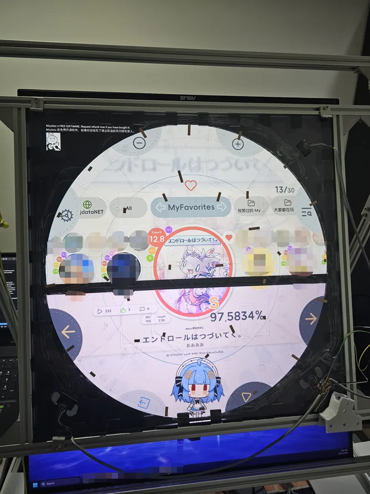
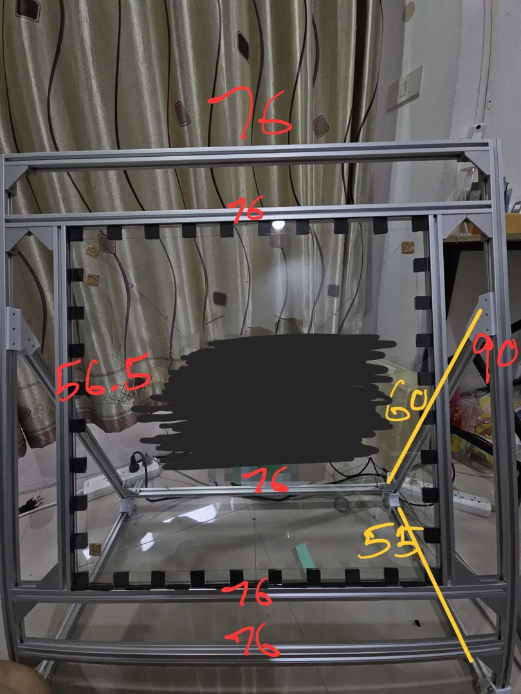
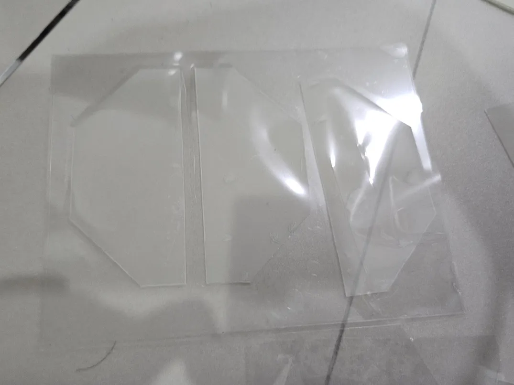
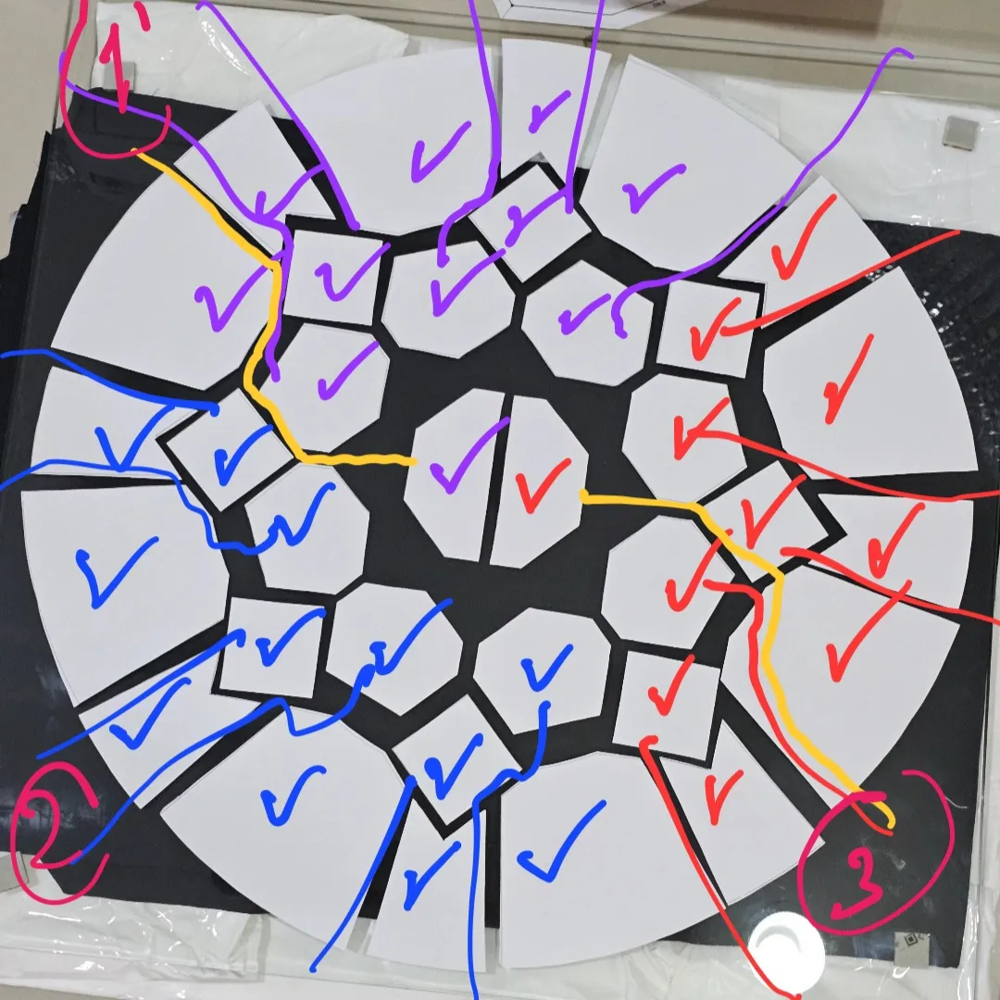
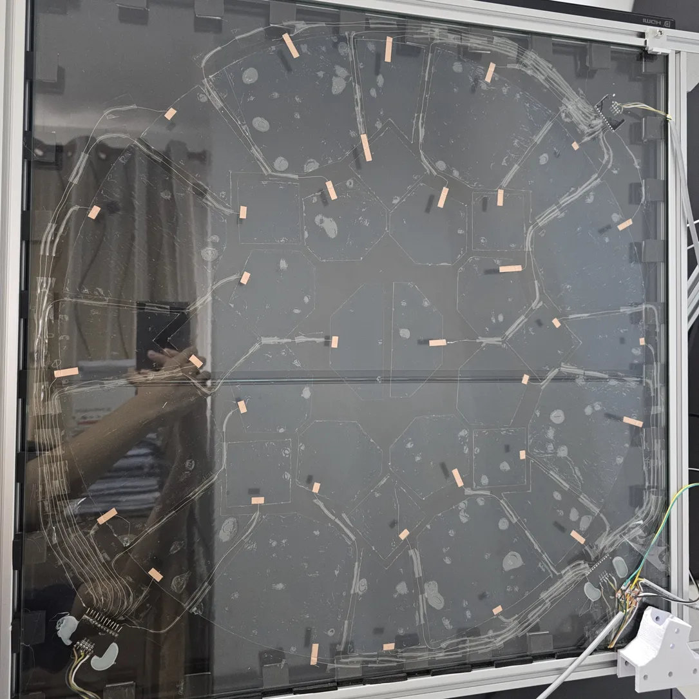
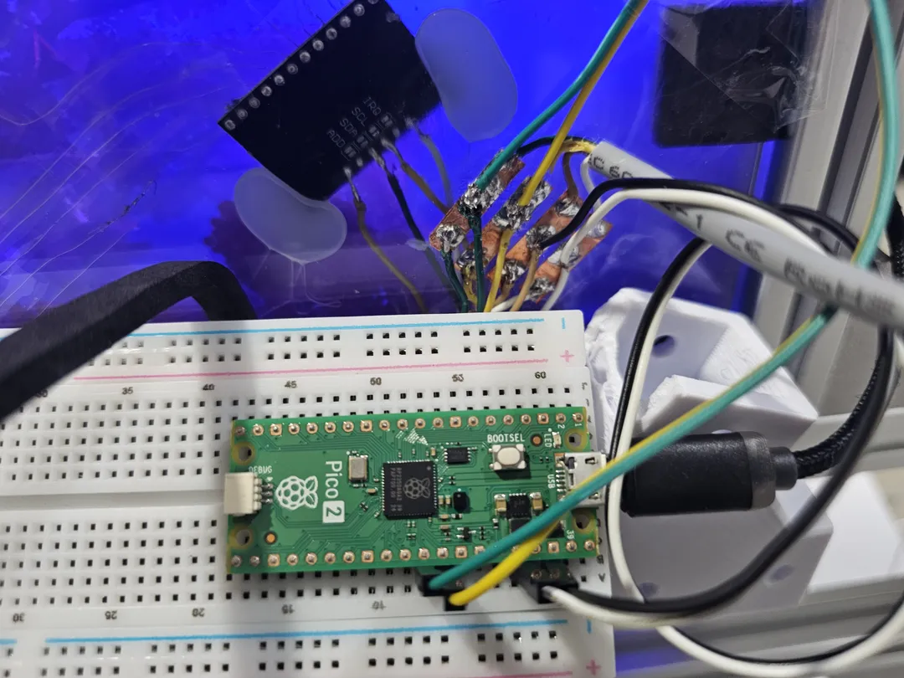

# My washing machine game
I made this circular game controller at home without any power tools and keeping the cost as low as possible so the design might look very different from other peoples build.

## The problems
> Cost and space are my first concerns, so instead of using 42inch tv i use two 27 inch monitor + 1 laptop monitor for sub display this way i can easily get 120fps or even higher for fraction of a price of 43inch tv because for most small tv the 120hz varient only sony bravo lcd and lg c oled both are more premium models at around 22k thb but mine can go as low as 7,000 thb as of today (included monitor arm) and can be use as normal desktop monitor saving spaces a lot.
> Another concerns is that I don't power tools so all of my materials are pre-cut and i can build this only with a few screws and a soldering iron.

Note: **Currently I have finished only 80% of the project that is touch sensors but it is 99% playable at this stage.**

<b>Table of Contents</b>

  
- [Header](#my-washing-machine-game)
- [Price summary](#price-summary)
- [Bill of Materials](#bill-of-materials)
- [References](#References)
  

# Price summary
The controller itself cost less than 6,000 thb not including the screens.
For monitor on the top I have Asus VG279 and the bottom one is Lenovo 27U-10.
You can use your old monitor or if buying new one you can fine entry level 27inch 144hz monitor for as low as 2,800thb and a monitor arm.

# Bill of Materials

## Touch Screen

| Qty | Item | Notes |
|---|---|---|
| 4 | OTA coated A4 PET film one side no glue | < 40 ohm/square. Mine are 27ohm/square and being cut slightly smaller than A4, the pdf file have compensates on both axes |
| 20 | OCA glue 7.9in | check dimensions first it must fit largest A pad. 7.9in is for tablet-sized not phone |
| 1 | Pi Pico 2 | |
| 3 | MPR121 breakout board | |
| 1 | Breadboard and wires | or solder directly to the Pico (only a few wires) |
| 2m | 4-core wire | |
| 1 | Double-sided conductive copper tape | |
| 1 | 0.1 mm copper wire | or strip any stranded wire |
| 1 | Clear tape | |
| 1 | Hot glue | or use OCA / clear tape |
| 1 | 5 mm tempered glass, 560x560 mm | |
| - | 2 mm EVA foam | for padding the glass |
| 1 | 3D printer + 400g PETG | for 70 and 40 deg angled bracket or buy metal one |
| 2 | 40 deg angled bracket | PETG 10 layer wall |
| 4 | 70 deg angled bracket | PETG 10 layer wall |

## Frame (2020 Aluminium)

| Qty | Length |
|---|---|
| 2 | 550 mm |
| 2 | 565 mm |
| 2 | 600 mm |
| 5 | 760 mm |
| 2 | 900 mm |

| Qty | Item | Notes |
|---|---|---|
| 14 | Angle bracket | |
| 38 | Shelf support for 2020 | you actually need only 4 on each corner and risk it break |
| - | Screws and fasteners | |

## Buttons

Buy one or 3d print.

| Qty | Item | Notes |
|---|---|---|
| 3m | 9 core wire | I use 10 core |
| 8 | Mechanical keyboard switch | I'm not using optical switch lever |
| 8 | Rod R=5mm L=80mm | |
| 1 | 3D printer + 2kg PETG | |

# Assembly
## Frame

## Glass
### ITO 
Cut 4 Sheet of A4 pattern from PDF then apply OCA glue if your ITO doesn't have glue, go very slowly remove amy bubbles. Don't worry if there are bubbles you won't notice it anyway during gameplay.

Clean the glass with 99% isopropyl alcohol then stick the ITO to it conductive side facing up, same here go slowly and remove bubbles.
There should be 2cm gap on all 4 sides for mounting to the frame.

### MPR121
Cut the ADDR pad on all 3 MPR121 then stick it to 3 corner of glass with either hot glue or your leftover OCA (OCA give a cleaner and stronger result) then daisy chain all 3 with 4 core wire SDA/SCL/VDD/VSS. 
For ADDR connect 3 of then differently. 
#1 ADDR -> VSS(3v3) = 0X5A 
#2 ADDR -> VDD(GND) = 0X5B 
#3 ADDR -> SDA(I2C) = 0X5C 

### Wiring
Strip a wire for small strands or use small 0.1mm copper wire then trace it from every pad to 3 corner with MPR121.
Connecting wire to ITO pad you should clean the pad first with isopropyl alcohol carefully do not scratch the surface then test the resistance it should be around 50R with 1mm gap if it exceed move to another location then attatch copper tape to pad bridging outside to glass, give it at least 1cm on the pad if using 5mm wide tape larger contact area will ensure stability and prevent ghosting, if you see ghosting remove copper tape with isopropyl alcohol CAREFULLY then test the resistance this time it is 50/50 if the pad is still good, then solder the tape that is on the glass, if you solder on the pad copper can lift a bit and break connection (it will look fine but have ghost input, you can see raw mpr121 data that it rise/fall too little, too slow or not rise back up).

## Controller
GND(PIN 38) -> VSS(3v3) 
3V3(PIN 36) -> VDD(GND) 
SDA(PIN 26) -> SDA(I2C) 
SCL(PIN 27) -> SCL(I2C) 

If you want usb-c you can connect to 2 test pad under the raspberry pi (D+ D-) VBUS and GND don't forget to add two 5.1kR pull-down to CC1 and CC2.

# References
For touch pad pattern and button 3D model https://github.com/Syndric/maimai-controller-fullsize
